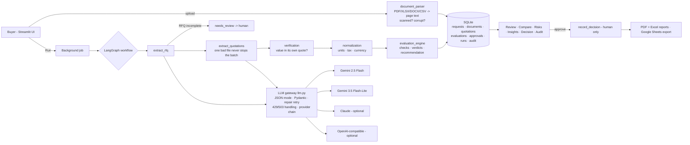

# Architecture

## 1. The idea in one paragraph

The AI is only used where something has to make sense of messy text: reading quotes that all look different.
Anything that decides an outcome is ordinary, tested Python, so it gives the same answer every time and can
explain itself. A person approves the final choice.

| Step | Who | Why |
|---|---|---|
| Read documents, find values, quote the source | AI (Gemini; fallback chain) | Layouts, wording and formats vary endlessly |
| Check the AI's numbers against its own quotes | Python (`verification.py`) | Catch silent conversions / misreads (F13) |
| Units, tax basis, currency | Python (`normalization.py`) | Arithmetic must be exact and explainable |
| PASS / FAIL / UNKNOWN per requirement, verdicts, ranking | Python (`evaluation_engine.py`) | Same input -> same answer, every answer has a reason |
| Clarification e-mails, savings, robustness | Python templates / formulas | Every sentence traceable to a check |
| Approve / reject | Human | Accountability stays with the buyer |

## 2. Components and data flow

Workflow states: `CREATED -> DOCUMENTS_UPLOADED -> EXTRACTING -> EVALUATING -> READY_FOR_APPROVAL -> APPROVED -> REPORT_GENERATED`
(plus `EXTRACTION_REVIEW_REQUIRED`, `REJECTED`, `FAILED`). Illegal transitions are rejected (`db.ALLOWED`).

## 3. Data contracts (`app/schemas.py`)

- `RFQRequirements` - product, quantity, unit, technical requirements (`name, operator, value, unit, mandatory`),
  certificates, max delivery, payment terms, currency, `evidence{field: Evidence}`.
- `SupplierQuotation` - price (`unit_price`, `price_per`, `currency`, `tax_status`, `tax_rate_percent`, freight),
  delivery, validity, payment, specifications, certificates, exclusions, `conflicts`, `verification_warnings`, evidence.
- `Evidence` - `source_document, page, quote, confidence` (confidence is the model's own, uncalibrated).
- `SupplierEvaluation` - `checks[RequirementCheck(status, required, offered, reason)]`, normalized price, total,
  findings; computed `overall_status`, `risk_level`.

**Missing = `None`, never 0.** Unknown is never treated as a pass. Null evidence for absent values is dropped,
not rejected (F2). Every AI answer is validated; one repair retry sends the validation error back to the model.

## 4. Reliability design

| Risk | Mechanism | Evidence |
|---|---|---|
| Invalid AI output | JSON mode, temperature 0, Pydantic validation, repair retry, failing fields logged (not values) | F1, F2 |
| Overload / rate limit / daily quota | Provider chain; 1 quick retry then next backend; wait only for short 429s; daily quota by `quotaId` | F6, F8, F12 |
| Retired model IDs | `scripts/check_ai.py` pre-flight | F9 |
| AI does arithmetic / misreads | Evidence check -> REVIEW_REQUIRED until a human confirms | F13 |
| One bad document | Recorded per document; batch continues; clear user message | TC-10 |
| Partial results look complete | Recommendation prefixed `INCOMPLETE`, red banner, approval needs confirmation + comment | F7 |
| UI rerun kills processing | Background job, live progress, resume of interrupted runs | F10 |
| Repeated cost | Completed extractions reused on re-run (and after human corrections) | |

## 5. Key decisions and trade-offs

| Decision | Alternative | Why |
|---|---|---|
| Streamlit calls Python services directly | FastAPI backend (blueprint) | 2 days left; one process is easier to run and hand over. API layer is a next-iteration item |
| Gemini reads scanned PDFs | Tesseract OCR | No native install on Windows; vision quality is better; flagged "please verify" |
| SQLite + validated JSON columns | Fully normalized tables | Schema = Pydantic contract; fast to evolve; adequate for single user |
| LangGraph for orchestration, approval **outside** the graph | Approval as a graph node | An AI-run graph must not be able to pass the approval step |
| Deterministic rules + no weighted score in the verdict | Weighted score | Mandatory failures can never be offset by price; scorecard shows real values only |
| Provider chain with opt-in backups | Several free keys of one provider | Key rotation breaks provider terms; each extra provider is a documented privacy decision |
| Pinned model IDs | `-latest` / `-preview` | Reproducible evaluation results |

## 6. Security and privacy

- Keys only in `.env` (git-ignored); `.env.example` has none. Logs never contain document text or keys.
- Uploads: extension + content signature check, size limit (15 MB), random internal file names, never executed.
- Every enabled AI provider receives document content: backups are off until configured; documented in `.env.example`.
- Local storage by default (`data/`); evaluations can be deleted (files + records); full audit trail.

## 7. Not built (scope)

Purchase orders, ERP, payments, supplier onboarding, negotiation, multi-user auth, multi-tenant deployment,
FastAPI layer, Drive import. See the next-iteration plan in [case_study.md](case_study.md).
